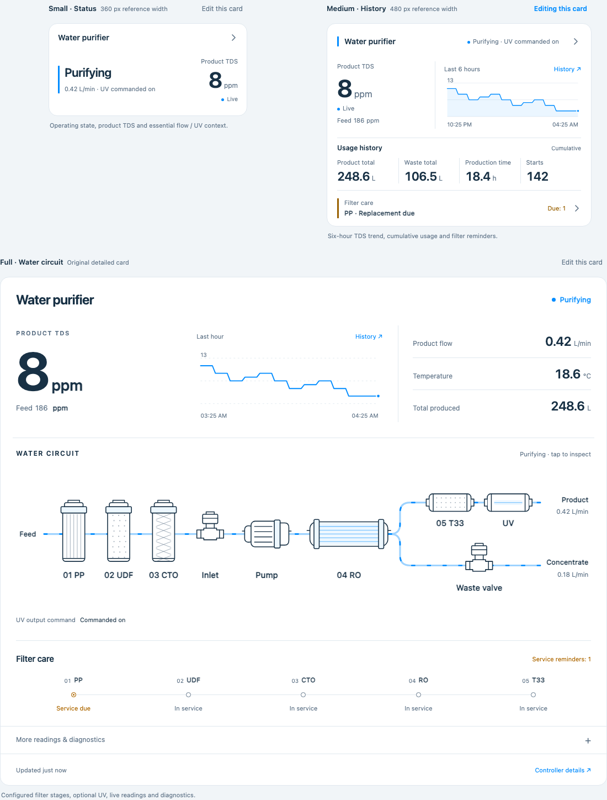

# Water Purifier Card

A family of **three read-only Home Assistant cards** for RO water purifiers, with **11 interface languages** in one JavaScript file: a full water-circuit card, a small status card, and a medium quality/history card.

Source repository: [lmx566/water-purifier-card](https://github.com/lmx566/water-purifier-card).

[中文安装说明](docs/INSTALL.zh-CN.md)

**Status: unreleased 0.4.0 source candidate.** The three cards have recorded local functional, multilingual and responsive checks in Chromium and WebKit, plus targeted manual checks in Home Assistant. Official HACS validation has not been recorded; HACS installation/update and default-catalog acceptance remain unverified. See the [validation record](docs/FRONTEND-VALIDATION.md) for the tested revision, results and limits.

A subsequent display-only adjustment removes the normal UV command suffix from the small and medium cards' status areas, keeping device status consistent across all three cards. Fault descriptions and the full card's separate UV details remain available. That adjustment has been source-reviewed, not rerun through the recorded suites.



The screenshot is a real browser capture of the **synthetic preview**, using example readings. It was captured **before the UV status text adjustment** described above, so the small and medium cards still show the old UV suffix in this image. It is not a screenshot of a user's Home Assistant installation or measured device data.

## Choose a card

| Card | Type | Default layout | Purpose |
| --- | --- | --- | --- |
| Full card | `custom:water-purifier-card` | `full` | Existing detailed quality, water-circuit, filter and diagnostic view |
| Small status card | `custom:water-purifier-status-card` | `small` | Operating state, product TDS and product flow at a glance |
| Medium history card | `custom:water-purifier-history-card` | `medium` | Product/feed TDS, recorded TDS trend, cumulative usage and filter reminders; no circuit |

The small and medium designs target approximately 360 × 168 px and 480 × 300 px respectively; actual dimensions follow the HA card container and content. All three use the same device selection, entity mappings, filter configuration and resource file. They can coexist on a dashboard. The earlier `layout: compact` configuration remains accepted as an alias for `small`.

The medium card's usage row contains **Product total**, **Waste total**, **Production time**, and **Starts**. These are cumulative device counters, not today's figures or the chart's selected time window. Production time records accumulated commanded production duration, not device uptime. The TDS graph is separate Home Assistant Recorder history and defaults to six hours in the medium layout.

## Design and behavior

- Eleven interface languages, automatically following Home Assistant or selected per card; translated card content, editor and status messages. No brand logo in the header.
- Large product TDS reading, feed-water comparison, real HA history trend, and aligned flow, temperature, and cumulative-volume readings.
- Full card: original inline SVG with three prefilters, inlet valve, pump, horizontal RO membrane, and rounded product/concentrate branches. Product finishing can include T33 and UV. No downloaded product photos, glass effects, external fonts, or CDN.
- Filter reminders use a continuous rail in full and a prioritized summary in medium. Up to eight slots are supported; no remaining-life percentages or days are invented from reminder enums.
- Full, small and medium layouts, HA theme colors, keyboard details, and reduced-motion support. The full layout retains its card-width-responsive circuit.
- Small status and medium history cards follow the selected white, water-blue and dark-data concepts without embedding the generated concept images in the runtime.
- Faults, unknown data and offline state remain explicit. A reported idle phase may be displayed as standby; it is not evidence that automatic operation is armed. Filter reminders that are disabled or unknown are not treated as healthy plans.
- Selecting a reading or a mapped component opens HA's entity details. An optional link opens the controller's own dashboard. The card sends no start/stop, rinse, reset, or other device command.
- One JavaScript file, no runtime dependencies or build step. HA hosts it; the browser renders it. It is not installed on the ESP32.

Animation follows the reported operating phase; it is not proof of measured flow or actual valve movement. UV command state does not establish UV intensity or disinfection performance.

## Add it to Home Assistant

There are two separate pieces: **MQTT supplies the device entities; this card displays them. HACS only manages the frontend file.**

### 1. Connect the device data

Configure Home Assistant's [MQTT integration](https://www.home-assistant.io/integrations/mqtt/) and set the controller's **Network → MQTT / Home Assistant** page to use the same broker. Confirm that a WATER device and its sensor entities appear in HA. If this is already working, keep that connection; installing the card does not require another firmware flash.

### 2. Install manually

1. Open [`water-purifier-card.js`](water-purifier-card.js) in this repository and use GitHub's **Download raw file** button. Save the actual JavaScript file, not the GitHub HTML page.
2. Copy it to the HA configuration directory as `www/water-purifier-card.js` (commonly `/config/www/water-purifier-card.js`).
3. If `www` was just created, restart HA once so it serves the directory.
4. Open **Settings → Dashboards → ⋮ → Resources → Add resource**. Use `/local/water-purifier-card.js?v=0.4.0` and choose **JavaScript module**.
5. Reload the browser. Edit a dashboard and choose the full, status or history Water Purifier card from the picker. Select the WATER device in its visual editor. Alternatively use the YAML examples below.

Register the file **once for all three cards**. To upgrade an existing installation, replace its `water-purifier-card.js`, change the existing resource's version query to `v=0.4.0`, and refresh the browser. Do not add three resource entries. If using `www/water-purifier-card/`, keep that folder and update its existing URL rather than loading a second copy. This frontend update does not require a firmware flash when the required MQTT entities already exist. These paths and resource steps follow the [HA resource documentation](https://contributors.home-assistant.io/frontend/custom-ui/resources/).

For an installation that already manages resources in YAML, merge the following into its existing configuration rather than adding a second `lovelace` key:

```yaml
lovelace:
  resource_mode: yaml
  resources:
    - url: /local/water-purifier-card.js?v=0.4.0
      type: module
```

With YAML-managed resources, reload dashboard resources after changing the list, then reload the browser. UI-managed installations can use the Resources page directly.

### 3. Add the card

For automatic entity matching, choose the device in the visual editor, or use its **Home Assistant device registry ID**:

```yaml
type: custom:water-purifier-card
title: Kitchen water
device_id: REPLACE_WITH_HA_DEVICE_REGISTRY_ID
layout: full
animate: true
show_history: true
history_hours: 1
dashboard_url: http://192.0.2.1/ui/
```

To add the other two cards for the same device, create two additional manual cards:

```yaml
type: custom:water-purifier-status-card
title: Kitchen water
device_id: REPLACE_WITH_HA_DEVICE_REGISTRY_ID
dashboard_url: http://192.0.2.1/ui/
```

```yaml
type: custom:water-purifier-history-card
title: Kitchen water
device_id: REPLACE_WITH_HA_DEVICE_REGISTRY_ID
history_hours: 6
dashboard_url: http://192.0.2.1/ui/
```

The example dashboard URL uses a documentation-only address; replace it with your controller's address. It opens in the user's browser and must be reachable from that browser. It is not an API address the card polls.

The HA registry ID is different from the firmware identifier `water_<MAC>`. Do not paste the MAC identifier into `device_id`. Explicit entity mappings are also supported; see the [full](examples/configuration.yaml), [small](examples/status-card.yaml), and [medium](examples/history-card.yaml) examples. The common visual editor exposes the three layouts, shared device selection and mappings.

### Alternative: HACS custom repository

The repository is structured for HACS, but an actual HACS installation/update has not yet been verified. The manual installation above has been exercised in Home Assistant.

1. Open **HACS → ⋮ → Custom repositories**.
2. Enter `https://github.com/lmx566/water-purifier-card` and choose **Dashboard**, then add the repository.
3. Find **Water Purifier Card** in HACS and download it.
4. Check **Settings → Dashboards → ⋮ → Resources** for one **JavaScript module** resource at `/hacsfiles/water-purifier-card/water-purifier-card.js`. Add that entry only if HACS did not create it.
5. If switching from manual installation, remove the previous `/local/water-purifier-card.js…` resource entry so only one copy loads. Reload the browser, then add any of the three card types using the picker or YAML examples above.

This project has not been accepted into HACS's default catalog; adding its custom repository is required. If HACS installation fails, use the manual steps and include the HACS error in a [bug report](https://github.com/lmx566/water-purifier-card/issues). See [HACS custom repositories](https://hacs.xyz/docs/faq/custom_repositories/) and [Dashboard repository requirements](https://hacs.xyz/docs/publish/plugin/).

## Configuration reference

| Option | Default | Purpose |
| --- | --- | --- |
| `type` | Required | One of the three card types listed above |
| `title` | Translated “Water purifier” | Optional custom header, at most 100 characters; custom text is preserved across language changes |
| `language` | `auto` | Follow HA language, or select a supported locale for this card only |
| `layout` | Card-type default | `full`, `small`, or `medium`; legacy `compact` normalizes to `small` |
| `animate` | `true` | Animate valid production/flush paths in the full card; reduced-motion preference takes precedence |
| `show_history` | `true` | Request a product TDS trend in full/medium layouts; small never requests history |
| `history_hours` | `6` for medium, otherwise `1` | History window, integer from 1 to 24 hours; an explicit value takes precedence |
| `dashboard_url` | Device registry URL when available | Optional `http://` or `https://` controller dashboard link without embedded credentials; an explicit empty string hides it |
| `device_id` | Unset | HA registry ID for exact device/entity matching |
| `entities` | Unset | Explicit role-to-entity overrides; `null` hides a role |
| `filters` | Derived from mapped `filter_1` … `filter_8` | Up to eight `{name, entity, stage?}` entries; `[]` hides the maintenance list |
| `stages` | Unset | Explicit `pp`, `udf`, `cto`, `ro`, `post` maintenance click-target associations for the full circuit |

Device matching reads HA's registries using the existing authenticated HA connection. It matches the chosen WATER MQTT identifier and exact entity unique IDs, excluding disabled registry entries. It does not construct entity IDs or select another controller's sensor. Explicit `entities` mappings take precedence; omitted keys allow matching, while `null` explicitly hides the role. Manual mapping remains usable when registry access is unavailable.

### Entity roles

| Key | Data |
| --- | --- |
| `state`, `fault` | Controller phase and fault strings |
| `feed_tds`, `product_tds` | Numeric TDS with entity unit |
| `feed_temperature`, `product_temperature` | Numeric temperature with entity unit |
| `flow`, `waste_flow` | Product and concentrate flow rates |
| `water_total`, `waste_total` | Cumulative volumes, not today's volumes |
| `recovery` | Reported RO recovery percentage |
| `production_hours`, `uptime`, `starts`, `faults` | Operating counters |
| `outputs` | Firmware output capability; not physical feedback |
| `pump_voltage`, `pump_current`, `uv_voltage`, `uv_current` | Electrical measurements; not on/off state |
| `filter_1` … `filter_8` | Maintenance reminder enums |
| `uv_enabled` | Firmware `uv_enabled` sensor: `enabled` / `disabled` |
| `uv` | Firmware `uv_command` sensor: `commanded_on` / `off` |
| `uv_status` | Firmware `uv_status` sensor: configuration, feedback, fault, or command state |
| `pump`, `inlet`, `flush`, `pressure`, `leak` | Optional independently supplied entities with the stated meaning |

The current firmware discovers the three UV entries as **sensors**, not switches or binary sensors. It does not currently discover dedicated pump/inlet/waste-valve command, pressure, or wet/dry leak entities. Bind those optional roles only if a separate real source provides them. Voltage/current values and the controller phase must not be substituted for physical switch feedback. UV is hidden when its enabled entity explicitly reports disabled; a mapped but unknown state remains explicit instead of being guessed from current.

### Filters and circuit associations

The firmware has eight reminder slots. It does not publish filter names, kinds, positions, or remaining-life percentages through this MQTT contract. Configure names and optional `stage` associations to match the actual installation. For the five-filter installation in this project:

```yaml
filters:
  - {name: PP, entity: sensor.kitchen_filter_1, stage: pp}
  - {name: UDF, entity: sensor.kitchen_filter_2, stage: udf}
  - {name: CTO, entity: sensor.kitchen_filter_3, stage: cto}
  - {name: RO, entity: sensor.kitchen_filter_4, stage: ro}
  - {name: T33, entity: sensor.kitchen_filter_5, stage: post}
```

Replace these illustrative entity IDs with actual IDs from HA. When every entry of a nonempty custom `filters` list has a `stage`, the diagram shows the included stage types, with one symbol per type. Mixed or untagged lists retain the five-stage illustrative circuit. The diagram is not a general plumbing editor and does not draw multiple copies of one stage type.

`not_fitted` means the slot is not installed and is omitted from the automatic maintenance list. `disabled` means its reminder is off, which does not mean the physical filter is absent. Missing or unavailable configured entities remain distinguishable from those states.

Existing `stages` mappings change only component click targets; they do not remove a stage. An explicit mapping overrides an association from `filters`; `null` leaves the component without a maintenance target. Reminder state is not a measurement of filtration effectiveness.

### History

The full and medium trends use the mapped product TDS entity and HA's own [history API](https://contributors.home-assistant.io/core/internals/rest-api/). They do not read the ESP32 history partition or generate sample points in the real card. HA history/Recorder must contain records for that entity. Empty history, excluded entities, permissions, or history errors are shown as unavailable/empty states; live readings can still work. Gaps in unavailable readings remain gaps. The default window is one hour for full and six hours for medium; history refresh is throttled rather than requested for every MQTT update. The small layout makes no history requests, even if `show_history` is true.

The medium cumulative row reads the four mapped counter entities directly. It does not derive day/week/month totals by relabeling them. Missing or unavailable counter values remain unknown rather than becoming zero.

## Languages and regional formatting

All three cards and the shared visual editor support these languages in the same JavaScript resource:

| Language | Configuration value |
| --- | --- |
| English | `en` |
| 简体中文 | `zh-Hans` |
| 繁體中文 | `zh-Hant` |
| Deutsch | `de` |
| Français | `fr` |
| Español | `es` |
| Italiano | `it` |
| Nederlands | `nl` |
| Português (Brasil) | `pt-BR` |
| 日本語 | `ja` |
| 한국어 | `ko` |

The default `language: auto` follows the current HA user's language. Unsupported automatic languages fall back to English. A manual choice applies only to that card, so cards in different languages can coexist. The editor exposes the same choice. The dictionaries are embedded: installing through HACS does not require downloading translation files, using a CDN, or connecting the controller to the internet.

The card picker's registered names/descriptions use the browser language when the resource first loads. Mounted cards and their editors receive HA's user preferences and use the language behavior described above.

```yaml
type: custom:water-purifier-history-card
device_id: REPLACE_WITH_HA_DEVICE_REGISTRY_ID
language: auto
history_hours: 6
```

For a card that should always use Simplified Chinese, set `language: zh-Hans`; for German, use `language: de`. Common region aliases such as `en-US`, `de-DE`, `zh-CN` and `zh-TW` resolve to the corresponding supported translation. Brazilian Portuguese is the provided Portuguese translation. Machine-readable configuration keys, entity IDs, units and firmware protocol identifiers do not change.

Default card titles and automatically named reminder slots are translated. **Explicit `title` and custom `filters[].name` values remain exactly as entered.** If an older configuration contains `title: Water purifier`, remove the `title` line to use the translated default. Your own device names and HA entity names remain user content.

Numbers and history times follow HA's regional preferences, including number separators, 12/24-hour time and local/server timezone selection. Choosing a different card language does not overwrite those preferences. Unknown device state/fault identifiers remain visible rather than being translated into a healthy state. All eleven locales were exercised in both local browser engines; native-speaker review and full real-HA language/formatting acceptance remain pending.

## Preview and verification status

`preview.html` uses synthetic HA-like data and does not connect to the controller or a real HA server. Its language, number-format and clock controls let maintainers inspect locale changes manually; the card editor can also set a separate language for each card. Only `water-purifier-card.js` is the runtime resource; do not install the preview, demo fixture, or tests as resources.

On 2026-11-08, **Chromium 156.0.8078.4 and WebKit 26.5 each passed 24/24 functional, 33/33 multilingual and 36/36 responsive checks** on the same candidate resource. These local fixtures use synthetic HA registries, readings and history. Manual checks on **HA Core 2026.3.1 / Frontend 20260304.0** also confirmed three picker entries, discovery, live readings, real Recorder history, language/layout changes, save/reload and native entity details. Small/medium cards were saved on the dashboard; the full layout was checked in HA's editor preview. The [validation record](docs/FRONTEND-VALIDATION.md) separates those results from remaining acceptance work and preserves the earlier 0.1.0 evidence.

The recorded suites predate the later UV status text adjustment; that display change was source-reviewed without rerunning tests. Source publication does not establish HACS validation or a versioned release. Physical mobile apps/devices, native-speaker review, screen readers and the complete real-HA compatibility matrix remain unverified. No firmware was changed, compiled or flashed during this card validation. See [HACS readiness](docs/HACS-READINESS.md).

The card distinguishes missing, unknown, unavailable, and unmapped data. It does not recalibrate readings, guarantee drinking-water safety, or send device commands. The full schematic is a configured explanatory diagram, not automatic discovery of every pipe and fitting.

## Development

Edit the single JavaScript file directly. See [MQTT contract](docs/MQTT-CONTRACT.md), [design notes](docs/DESIGN.md), [contribution guidelines](CONTRIBUTING.md), [release instructions](docs/RELEASING.md), and [changelog](CHANGELOG.md).

Licensed under [MIT](LICENSE). Not affiliated with Home Assistant or HACS.
